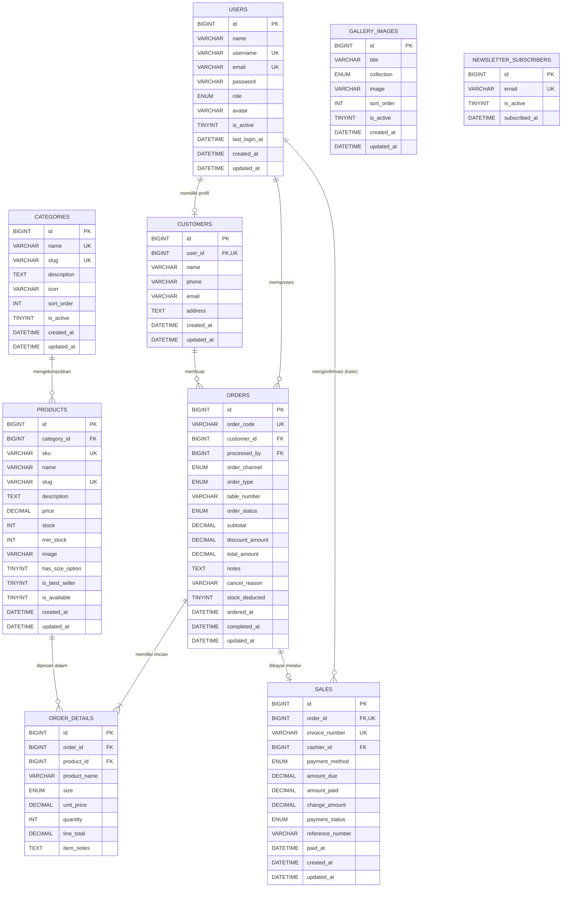

# ERD – KopiKita Coffee Shop Management System

Dokumen ini menjelaskan rancangan Entity Relationship Diagram (ERD) untuk **KopiKita**, website pemesanan dan pengelolaan penjualan coffee shop dengan slogan *A Little Coffee, A Lot of Happiness.* Database menggunakan MySQL dan dikelola melalui phpMyAdmin pada XAMPP. Rancangan ini mengikuti **PROMPT.md** dan **sitemap.md**.

## 1. Informasi database

| Properti | Keterangan |
|---|---|
| Nama database | `kopikita_db` |
| DBMS | MySQL / MariaDB |
| Pengelola database | phpMyAdmin |
| Backend | PHP (PDO) |
| Karakter dan kolasi | `utf8mb4` / `utf8mb4_unicode_ci` |
| Engine tabel | InnoDB |
| Jumlah tabel | 9 |

### Daftar tabel

| Kelompok | Tabel | Fungsi |
|---|---|---|
| Akun | `users` | Akun admin, kasir, dan pelanggan (login dengan username **atau** email). |
| Akun | `customers` | Nama dan kontak pelanggan; bisa terhubung ke akun atau pelanggan *walk-in* di kasir. |
| Katalog | `categories` | Coffee, Non-Coffee, Food & Pastry, Signature Drinks. |
| Katalog | `products` | Nama, harga, stok, batas stok minimum, foto, best seller. |
| Transaksi | `orders` | Nomor pesanan, tanggal, jenis, status, dan total. |
| Transaksi | `order_details` | Produk yang dipesan, ukuran, jumlah, catatan, harga snapshot. |
| Transaksi | `sales` | Data penjualan dan pembayaran: metode, nominal, kembalian, status bayar, kasir. |
| Konten website | `gallery_images` | Foto section *Popular Collections* / halaman Gallery. |
| Konten website | `newsletter_subscribers` | Email dari form *Stay up to date*. |

> **Catatan perubahan:** tabel pembayaran diberi nama `sales` sesuai PROMPT.md ("data penjualan dan pembayaran"). Satu baris `sales` mewakili satu transaksi pembayaran untuk satu pesanan. Omzet tidak disimpan dua kali; laporan dihitung dari `orders` yang `completed` dan `sales` yang `paid`.

## 2. Diagram ERD



`gallery_images` dan `newsletter_subscribers` adalah tabel konten yang berdiri sendiri (tidak berelasi), untuk mendukung section *Popular Collections* dan *Stay up to date* pada desain beranda.

### Ringkasan hubungan

| Relasi | Kardinalitas | Penjelasan |
|---|---|---|
| `users` – `customers` | 1 : 0..1 | Akun role `customer` memiliki satu profil pelanggan. Profil pelanggan *walk-in* yang dibuat kasir boleh tanpa akun (`user_id = NULL`). |
| `customers` – `orders` | 1 : banyak | Satu pelanggan dapat membuat banyak pesanan; satu pesanan dimiliki satu pelanggan. |
| `users` – `orders` | 1 : banyak (opsional) | Admin/kasir yang memproses pesanan dicatat di `processed_by`; `NULL` sebelum diproses. |
| `categories` – `products` | 1 : banyak | Satu kategori memiliki banyak produk; satu produk berada di satu kategori. |
| `orders` – `order_details` | 1 : banyak | Satu pesanan memiliki satu atau lebih rincian produk. |
| `products` – `order_details` | 1 : banyak | Satu produk dapat muncul di banyak rincian pesanan. |
| `orders` – `sales` | 1 : 0..1 | Pesanan bisa belum memiliki data penjualan, atau memiliki tepat satu. `sales.order_id` unik. |
| `users` – `sales` | 1 : banyak (opsional) | Kasir/admin yang mengonfirmasi pembayaran dicatat di `cashier_id`; `NULL` sebelum dikonfirmasi. |

## 3. Struktur tabel dan atribut

Semua tabel memakai `InnoDB` agar foreign key berlaku.

### 3.1 Tabel `users`

Akun untuk admin, kasir, dan pelanggan. Login menerima **username atau email**.

| Kolom | Tipe data | Aturan | Keterangan |
|---|---|---|---|
| `id` | BIGINT UNSIGNED | PK, AUTO_INCREMENT | ID akun. |
| `name` | VARCHAR(100) | NOT NULL | Nama lengkap. |
| `username` | VARCHAR(50) | NOT NULL, UNIQUE | Username untuk login (huruf kecil, angka, `_`). |
| `email` | VARCHAR(150) | NOT NULL, UNIQUE | Email untuk login. |
| `password` | VARCHAR(255) | NOT NULL | Hash dari `password_hash()`. |
| `role` | ENUM('admin','cashier','customer') | NOT NULL, DEFAULT 'customer' | Hak akses akun. |
| `avatar` | VARCHAR(255) | NULL | Foto profil (opsional). |
| `is_active` | TINYINT(1) | NOT NULL, DEFAULT 1 | Akun nonaktif tidak bisa login. |
| `last_login_at` | DATETIME | NULL | Waktu login terakhir. |
| `created_at` | DATETIME | NOT NULL | Waktu akun dibuat. |
| `updated_at` | DATETIME | NOT NULL | Waktu akun diperbarui. |

### 3.2 Tabel `customers`

Nama dan kontak pelanggan. Pelanggan online terhubung ke `users`; pelanggan *walk-in* dari kasir tidak wajib punya akun.

| Kolom | Tipe data | Aturan | Keterangan |
|---|---|---|---|
| `id` | BIGINT UNSIGNED | PK, AUTO_INCREMENT | ID pelanggan. |
| `user_id` | BIGINT UNSIGNED | NULL, FK, UNIQUE | Mengacu ke `users.id`. `NULL` untuk pelanggan walk-in. |
| `name` | VARCHAR(100) | NOT NULL | Nama pelanggan (disalin dari akun saat registrasi, atau diisi kasir). |
| `phone` | VARCHAR(25) | NULL | Nomor telepon/WhatsApp. |
| `email` | VARCHAR(150) | NULL | Email kontak. |
| `address` | TEXT | NULL | Alamat, bila diperlukan. |
| `created_at` | DATETIME | NOT NULL | Waktu dibuat. |
| `updated_at` | DATETIME | NOT NULL | Waktu diperbarui. |

> Sediakan satu baris default `Pelanggan Umum` (walk-in) agar kasir dapat membuat transaksi cepat tanpa mengisi data pelanggan.

### 3.3 Tabel `categories`

| Kolom | Tipe data | Aturan | Keterangan |
|---|---|---|---|
| `id` | BIGINT UNSIGNED | PK, AUTO_INCREMENT | ID kategori. |
| `name` | VARCHAR(80) | NOT NULL, UNIQUE | Nama kategori. |
| `slug` | VARCHAR(90) | NOT NULL, UNIQUE | Untuk filter URL, contoh `signature-drinks`. |
| `description` | TEXT | NULL | Deskripsi kategori. |
| `icon` | VARCHAR(50) | NULL | Nama ikon untuk chip filter. |
| `sort_order` | INT | NOT NULL, DEFAULT 0 | Urutan tampil chip kategori. |
| `is_active` | TINYINT(1) | NOT NULL, DEFAULT 1 | Ditampilkan atau tidak. |
| `created_at` | DATETIME | NOT NULL | Waktu dibuat. |
| `updated_at` | DATETIME | NOT NULL | Waktu diperbarui. |

Data awal:

| sort_order | name | slug |
|---|---|---|
| 1 | Coffee | `coffee` |
| 2 | Non-Coffee | `non-coffee` |
| 3 | Food & Pastry | `food-pastry` |
| 4 | Signature Drinks | `signature-drinks` |

### 3.4 Tabel `products`

| Kolom | Tipe data | Aturan | Keterangan |
|---|---|---|---|
| `id` | BIGINT UNSIGNED | PK, AUTO_INCREMENT | ID produk. |
| `category_id` | BIGINT UNSIGNED | NOT NULL, FK | Mengacu ke `categories.id`. |
| `sku` | VARCHAR(40) | NOT NULL, UNIQUE | Kode produk, contoh `CF-001`. |
| `name` | VARCHAR(120) | NOT NULL | Nama produk. |
| `slug` | VARCHAR(140) | NOT NULL, UNIQUE | Untuk URL detail produk. |
| `description` | TEXT | NULL | Deskripsi singkat untuk kartu katalog. |
| `price` | DECIMAL(12,2) | NOT NULL | Harga dasar (ukuran Regular). |
| `stock` | INT UNSIGNED | NOT NULL, DEFAULT 0 | Stok tersedia. |
| `min_stock` | INT UNSIGNED | NOT NULL, DEFAULT 10 | Batas stok menipis; produk dengan `stock <= min_stock` tampil di dashboard. |
| `image` | VARCHAR(255) | NULL | Nama file foto di `assets/images/products/`. |
| `has_size_option` | TINYINT(1) | NOT NULL, DEFAULT 1 | `1` = punya pilihan Regular/Large (minuman); `0` untuk makanan. |
| `is_best_seller` | TINYINT(1) | NOT NULL, DEFAULT 0 | Ditampilkan di carousel *Signature Collection* beranda. |
| `is_available` | TINYINT(1) | NOT NULL, DEFAULT 1 | Tampil/tidak di katalog (dipakai sebagai pengganti hapus). |
| `created_at` | DATETIME | NOT NULL | Waktu dibuat. |
| `updated_at` | DATETIME | NOT NULL | Waktu diperbarui. |

> **Pilihan ukuran:** biaya tambahan ukuran disimpan sebagai konstanta di `config/app.php` (contoh `SIZE_PRICES = ['regular' => 0, 'large' => 5000]`), sehingga tidak perlu tabel terpisah.

### 3.5 Tabel `orders`

| Kolom | Tipe data | Aturan | Keterangan |
|---|---|---|---|
| `id` | BIGINT UNSIGNED | PK, AUTO_INCREMENT | ID pesanan. |
| `order_code` | VARCHAR(30) | NOT NULL, UNIQUE | Kode pesanan, contoh `KK-20261112-0001`. |
| `customer_id` | BIGINT UNSIGNED | NOT NULL, FK | Mengacu ke `customers.id`. |
| `processed_by` | BIGINT UNSIGNED | NULL, FK | Mengacu ke `users.id` (admin/kasir yang memproses). |
| `order_channel` | ENUM('online','cashier') | NOT NULL, DEFAULT 'online' | `online` dari website pelanggan; `cashier` dari POS kasir. |
| `order_type` | ENUM('dine_in','takeaway') | NOT NULL | Makan di tempat atau dibawa pulang. |
| `table_number` | VARCHAR(10) | NULL | Nomor meja untuk dine-in. |
| `order_status` | ENUM('pending','confirmed','preparing','ready','completed','cancelled') | NOT NULL, DEFAULT 'pending' | Status proses pesanan. |
| `subtotal` | DECIMAL(12,2) | NOT NULL | Jumlah seluruh `line_total`. |
| `discount_amount` | DECIMAL(12,2) | NOT NULL, DEFAULT 0 | Potongan harga. |
| `total_amount` | DECIMAL(12,2) | NOT NULL | `subtotal - discount_amount`. |
| `notes` | TEXT | NULL | Catatan pesanan secara umum. |
| `cancel_reason` | VARCHAR(255) | NULL | Alasan pembatalan. |
| `stock_deducted` | TINYINT(1) | NOT NULL, DEFAULT 0 | Penanda stok sudah dikurangi, agar pengembalian stok saat batal tidak salah. |
| `ordered_at` | DATETIME | NOT NULL | Waktu pesanan dibuat (dipakai filter laporan). |
| `completed_at` | DATETIME | NULL | Waktu pesanan selesai. |
| `updated_at` | DATETIME | NOT NULL | Waktu diperbarui. |

Status pesanan:

| Nilai | Label | Keterangan |
|---|---|---|
| `pending` | Pending | Pesanan baru masuk |
| `confirmed` | Confirmed | Pesanan dikonfirmasi |
| `preparing` | Preparing | Sedang dibuat barista |
| `ready` | Ready | Siap disajikan |
| `completed` | Completed | Pesanan selesai |
| `cancelled` | Cancelled | Pesanan dibatalkan |

### 3.6 Tabel `order_details`

Nama dan harga produk disalin sebagai *snapshot* agar riwayat transaksi tetap benar walaupun katalog berubah.

| Kolom | Tipe data | Aturan | Keterangan |
|---|---|---|---|
| `id` | BIGINT UNSIGNED | PK, AUTO_INCREMENT | ID rincian. |
| `order_id` | BIGINT UNSIGNED | NOT NULL, FK (ON DELETE CASCADE) | Mengacu ke `orders.id`. |
| `product_id` | BIGINT UNSIGNED | NOT NULL, FK | Mengacu ke `products.id`. |
| `product_name` | VARCHAR(120) | NOT NULL | Snapshot nama produk. |
| `size` | ENUM('regular','large') | NULL | Ukuran; `NULL` untuk produk tanpa ukuran. |
| `unit_price` | DECIMAL(12,2) | NOT NULL | Snapshot harga satuan **termasuk** tambahan ukuran. |
| `quantity` | INT UNSIGNED | NOT NULL | Jumlah; harus > 0. |
| `line_total` | DECIMAL(12,2) | NOT NULL | `unit_price × quantity`. |
| `item_notes` | TEXT | NULL | Catatan khusus, contoh *less sugar*, *extra shot*. |

### 3.7 Tabel `sales`

Data penjualan dan pembayaran untuk setiap pesanan. Dibuat berstatus `pending` saat checkout, lalu dikonfirmasi kasir/admin.

| Kolom | Tipe data | Aturan | Keterangan |
|---|---|---|---|
| `id` | BIGINT UNSIGNED | PK, AUTO_INCREMENT | ID penjualan. |
| `order_id` | BIGINT UNSIGNED | NOT NULL, FK, UNIQUE | Mengacu ke `orders.id`; satu pesanan satu data penjualan. |
| `invoice_number` | VARCHAR(30) | NOT NULL, UNIQUE | Nomor struk/invoice, contoh `INV-20261112-0001`. |
| `cashier_id` | BIGINT UNSIGNED | NULL, FK | Mengacu ke `users.id` (kasir/admin yang mengonfirmasi). |
| `payment_method` | ENUM('cash','qris','bank_transfer') | NOT NULL | Metode pembayaran (QRIS/transfer bersifat simulasi). |
| `amount_due` | DECIMAL(12,2) | NOT NULL | Tagihan, sama dengan `orders.total_amount`. |
| `amount_paid` | DECIMAL(12,2) | NOT NULL, DEFAULT 0 | Uang yang diterima. |
| `change_amount` | DECIMAL(12,2) | NOT NULL, DEFAULT 0 | Kembalian (`amount_paid - amount_due`, untuk cash). |
| `payment_status` | ENUM('pending','paid','failed','refunded') | NOT NULL, DEFAULT 'pending' | Status pembayaran. |
| `reference_number` | VARCHAR(100) | NULL | Nomor referensi QRIS/transfer. |
| `paid_at` | DATETIME | NULL | Waktu dikonfirmasi lunas. |
| `created_at` | DATETIME | NOT NULL | Waktu dibuat. |
| `updated_at` | DATETIME | NOT NULL | Waktu diperbarui. |

### 3.8 Tabel `gallery_images`

Mendukung section **Popular Collections** (chip All, Coffee, Drinks, Food, Ambience, Desserts) dan halaman Gallery.

| Kolom | Tipe data | Aturan | Keterangan |
|---|---|---|---|
| `id` | BIGINT UNSIGNED | PK, AUTO_INCREMENT | ID foto. |
| `title` | VARCHAR(120) | NOT NULL | Judul/keterangan foto. |
| `collection` | ENUM('coffee','drinks','food','ambience','desserts') | NOT NULL | Koleksi foto. |
| `image` | VARCHAR(255) | NOT NULL | Nama file di `assets/images/gallery/`. |
| `sort_order` | INT | NOT NULL, DEFAULT 0 | Urutan tampil. |
| `is_active` | TINYINT(1) | NOT NULL, DEFAULT 1 | Ditampilkan atau tidak. |
| `created_at` | DATETIME | NOT NULL | Waktu dibuat. |
| `updated_at` | DATETIME | NOT NULL | Waktu diperbarui. |

### 3.9 Tabel `newsletter_subscribers`

Menyimpan email dari form **Stay up to date** di beranda/footer.

| Kolom | Tipe data | Aturan | Keterangan |
|---|---|---|---|
| `id` | BIGINT UNSIGNED | PK, AUTO_INCREMENT | ID pendaftar. |
| `email` | VARCHAR(150) | NOT NULL, UNIQUE | Email pendaftar. |
| `is_active` | TINYINT(1) | NOT NULL, DEFAULT 1 | `0` jika berhenti berlangganan. |
| `subscribed_at` | DATETIME | NOT NULL | Waktu mendaftar. |

## 4. Aturan bisnis dan validasi data

1. `username` dan `email` pada `users` harus unik. Login mencari akun berdasarkan username **atau** email, lalu `password_verify()`.
2. `role` menentukan hak akses: `admin`, `cashier`, atau `customer`. Akun `is_active = 0` ditolak saat login.
3. Registrasi pelanggan membuat baris `users` (role `customer`) dan baris `customers` dalam satu transaksi.
4. Produk hanya bisa dipesan jika `is_available = 1`, kategori aktif, dan stok mencukupi.
5. Harga, tambahan ukuran, subtotal, diskon, dan total **dihitung ulang di PHP**; nilai dari browser diabaikan.
6. Saat checkout, simpan `orders`, `order_details` (snapshot nama & harga), dan `sales` berstatus `pending` dalam satu transaksi (`BEGIN`, `COMMIT`, `ROLLBACK`).
7. **Stok dikurangi** ketika pesanan berubah ke `confirmed` (online) atau saat transaksi POS kasir disimpan, lalu `stock_deducted = 1`. Jika pesanan `cancelled` dan `stock_deducted = 1`, stok dikembalikan.
8. Urutan status yang diizinkan: `pending → confirmed → preparing → ready → completed`. `cancelled` hanya dari `pending` atau `confirmed`.
9. Pesanan hanya boleh `completed` jika `sales.payment_status = 'paid'`.
10. Pembayaran cash: `amount_paid` harus ≥ `amount_due`; `change_amount = amount_paid - amount_due`.
11. `order_status` (proses pembuatan) dan `payment_status` (pembayaran) adalah dua status berbeda.
12. **Laporan penjualan** hanya menghitung `orders.order_status = 'completed'` dan `sales.payment_status = 'paid'`.
13. Produk dengan `stock <= min_stock` ditandai **stok menipis**.
14. Data yang sudah dipakai di riwayat transaksi (produk, akun, kategori) tidak dihapus; cukup dinonaktifkan.

## 5. Contoh perhitungan transaksi

| Produk | Ukuran | Harga satuan | Jumlah | Total |
|---|---|---:|---:|---:|
| Kopi Susu Aren | Large (+Rp5.000) | Rp25.000 | 2 | Rp50.000 |
| Croissant | – | Rp15.000 | 1 | Rp15.000 |
| **Subtotal** | | | | **Rp65.000** |
| Diskon | | | | Rp5.000 |
| **Total pembayaran** | | | | **Rp60.000** |
| Dibayar (cash) | | | | Rp100.000 |
| **Kembalian** | | | | **Rp40.000** |

Rumus:

- `unit_price = products.price + tambahan_ukuran`
- `line_total = unit_price × quantity`
- `subtotal = SUM(line_total)`
- `total_amount = subtotal - discount_amount`
- `change_amount = amount_paid - amount_due`

## 6. Query dasar untuk dashboard dan laporan

Total penjualan per tanggal (dengan filter tanggal):

```sql
SELECT
    DATE(o.ordered_at)  AS tanggal,
    COUNT(o.id)         AS jumlah_transaksi,
    SUM(o.total_amount) AS total_penjualan
FROM orders AS o
INNER JOIN sales AS s ON s.order_id = o.id
WHERE o.order_status = 'completed'
  AND s.payment_status = 'paid'
  AND DATE(o.ordered_at) BETWEEN :tanggal_awal AND :tanggal_akhir
GROUP BY DATE(o.ordered_at)
ORDER BY tanggal ASC;
```

Produk paling banyak terjual:

```sql
SELECT
    od.product_name,
    SUM(od.quantity)   AS jumlah_terjual,
    SUM(od.line_total) AS nilai_penjualan
FROM order_details AS od
INNER JOIN orders AS o ON o.id = od.order_id
INNER JOIN sales  AS s ON s.order_id = o.id
WHERE o.order_status = 'completed'
  AND s.payment_status = 'paid'
GROUP BY od.product_id, od.product_name
ORDER BY jumlah_terjual DESC
LIMIT 5;
```

Produk dengan stok menipis:

```sql
SELECT p.sku, p.name, c.name AS kategori, p.stock, p.min_stock
FROM products AS p
INNER JOIN categories AS c ON c.id = p.category_id
WHERE p.is_available = 1
  AND p.stock <= p.min_stock
ORDER BY p.stock ASC;
```

Kartu ringkasan dashboard:

```sql
SELECT
  (SELECT COALESCE(SUM(o.total_amount), 0)
     FROM orders o JOIN sales s ON s.order_id = o.id
    WHERE o.order_status = 'completed' AND s.payment_status = 'paid') AS total_penjualan,
  (SELECT COUNT(*) FROM orders)                                       AS jumlah_pesanan,
  (SELECT COUNT(*) FROM products WHERE is_available = 1)              AS jumlah_produk,
  (SELECT COUNT(*) FROM customers)                                    AS jumlah_pelanggan;
```

## 7. Pengembangan berikutnya (opsional)

Fitur seperti voucher/promo, program loyalitas, reservasi meja, dan riwayat perubahan status pesanan dapat ditambahkan setelah fitur inti berjalan, dengan tabel tambahan seperti `promotions`, `customer_points`, `reservations`, atau `order_status_logs`. Tabel tersebut tidak termasuk ERD inti versi ini.

---

**Akhir dokumen ERD KopiKita.**
