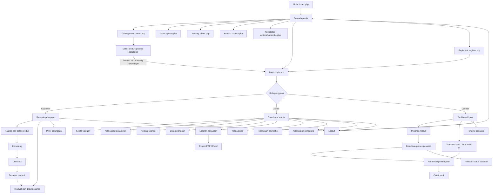
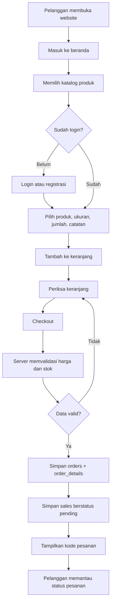
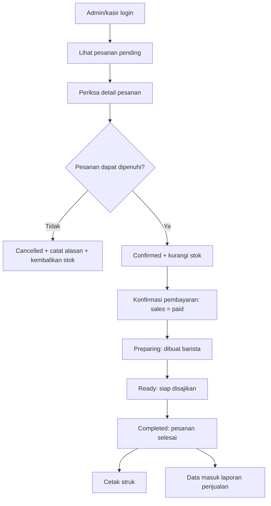
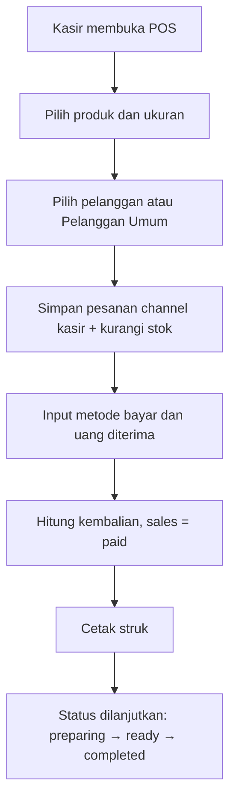

# Sitemap – KopiKita Coffee Shop Management System

Dokumen ini menjelaskan struktur halaman (sitemap), pembagian hak akses, dan alur navigasi website **KopiKita** (*A Little Coffee, A Lot of Happiness.*). Website dibangun dengan HTML, CSS, JavaScript, PHP, dan MySQL, dijalankan lokal melalui XAMPP. Dokumen ini mengikuti **PROMPT.md** dan **ERD.md**.

## 1. Tujuan sitemap

Sitemap menjadi panduan sebelum membuat halaman dan routing PHP. Sesuai PROMPT.md, KopiKita memiliki tiga tampilan utama ditambah area publik:

| Area | Tampilan | Gaya desain |
|---|---|---|
| Umum (guest) | Customer Website – sebelum login | Gelap *espresso*, teks krem, aksen oranye; Playfair Display + Poppins |
| Pelanggan (customer) | Customer Website – setelah login | Sama dengan area umum |
| Admin | Admin Dashboard | Sidebar cokelat gelap, konten cream; font Inter |
| Kasir (cashier) | Cashier System | Sama dengan admin, dioptimalkan untuk layar kasir/tablet |

## 2. Struktur sitemap



## 3. Daftar halaman dan fungsinya

### 3.1 Area umum (sebelum login)

| Halaman | File | Fungsi | Tabel |
|---|---|---|---|
| Beranda | `index.php` | Hero/banner promosi, strip highlight, carousel best seller, informasi kedai + statistik, Popular Collections, newsletter, footer. Tombol **Order Now**. | `products`, `categories`, `gallery_images` |
| Katalog menu | `menu.php` | Produk aktif dengan chip filter kategori (All, Coffee, Non-Coffee, Food & Pastry, Signature Drinks) dan pencarian. Tombol tambah ke keranjang mengarahkan ke login bila belum masuk. | `products`, `categories` |
| Detail produk | `product-detail.php?slug=...` | Foto besar, deskripsi, harga, ketersediaan, pilihan ukuran, jumlah, catatan. | `products` |
| Galeri | `gallery.php` | Koleksi foto Coffee, Drinks, Food, Ambience, Desserts dengan filter chip dan lightbox. | `gallery_images` |
| Tentang | `about.php` | Cerita KopiKita, 3 kartu nilai (Biji Pilihan, Barista Ahli, Ramah Lingkungan), baris statistik. | – |
| Kontak | `contact.php` | Alamat simulasi, jam operasional, kontak, peta (embed), tautan WhatsApp. | – |
| Login | `login.php` | Login dengan **username atau email** + password, lalu redirect sesuai role. | `users` |
| Registrasi | `register.php` | Membuat akun pelanggan beserta profil `customers`. | `users`, `customers` |
| Proses newsletter | `actions/subscribe.php` (POST) | Menyimpan email form *Stay up to date*, lalu kembali ke halaman asal dengan pesan. | `newsletter_subscribers` |

#### Susunan section beranda (`index.php`) – mengikuti referensi desain

| No | Section | Isi |
|---|---|---|
| 1 | Navbar | Logo KopiKita · Home, Menu, Gallery, About, Contact · ikon cari, ikon keranjang (badge), tombol **Sign In** / nama pengguna |
| 2 | Hero / banner promosi | Judul serif besar + slogan, paragraf, tombol **Order Now** dan **Explore Menu**, visual cup kopi dengan biji kopi melayang; slider promo |
| 3 | Strip highlight | 4 keunggulan dalam teks italic |
| 4 | Best seller | "Discover Our *Signature* Collection" – carousel produk `is_best_seller = 1` |
| 5 | Informasi kedai | 2 foto, teks tentang kedai, 3 kartu fitur, statistik (tahun berdiri, barista, biji lokal, pelanggan) |
| 6 | Popular Collections | Chip filter + kartu koleksi (1 foto besar, 3 thumbnail, jumlah foto) dari `gallery_images` |
| 7 | Newsletter | "Stay up to date" + input email + tombol Subscribe |
| 8 | Footer | Logo & slogan, Quick Links, Informasi (jam buka, alamat), Social Media, hak cipta |

### 3.2 Area pelanggan

Semua halaman wajib memeriksa session dan memastikan role `customer`. Navbar dan gaya sama dengan area umum.

| Halaman | File | Fungsi |
|---|---|---|
| Beranda pelanggan | `customer/index.php` | Sapaan, pesanan aktif beserta status, menu best seller. |
| Katalog menu | `customer/menu.php` | Produk dengan filter kategori; tambah ke keranjang langsung. |
| Detail produk | `customer/product-detail.php?slug=...` | Pilih ukuran (Regular/Large), jumlah, catatan khusus. |
| Keranjang | `customer/cart.php` | Daftar produk dipilih, ubah jumlah/ukuran/catatan, hapus item, subtotal. |
| Aksi keranjang | `customer/cart-action.php` (POST) | Tambah, ubah, hapus item di session (dipanggil form/`fetch`). |
| Checkout | `customer/checkout.php` | Jenis pesanan (dine-in + nomor meja / takeaway), catatan, metode bayar, ringkasan total, tombol **Buat Pesanan**. |
| Pesanan berhasil | `customer/order-success.php?code=...` | Kode pesanan, ringkasan, instruksi pembayaran (simulasi). |
| Riwayat pesanan | `customer/orders.php` | Daftar pesanan milik pelanggan dengan badge status. |
| Detail pesanan | `customer/order-detail.php?code=...` | Item, ukuran, jumlah, total, status pembayaran, *timeline* status (Pending → Completed). |
| Profil | `customer/profile.php` | Ubah nama, telepon, alamat, dan password. |

### 3.3 Area admin

Semua halaman wajib memeriksa session dan role `admin`.

| Halaman | File | Fungsi |
|---|---|---|
| Dashboard | `admin/index.php` | Kartu total penjualan, jumlah pesanan, produk, pelanggan; grafik penjualan; pesanan terbaru; produk terlaris; stok menipis; filter tanggal. |
| Kelola kategori | `admin/categories/index.php` | Daftar kategori. |
| Tambah kategori | `admin/categories/create.php` | Menambah kategori. |
| Edit kategori | `admin/categories/edit.php?id=...` | Mengubah nama/slug/deskripsi/urutan/status. |
| Kelola produk & stok | `admin/products/index.php` | Daftar produk, harga, stok, badge stok menipis, filter kategori. |
| Tambah produk | `admin/products/create.php` | Menambah produk, foto, kategori, harga, stok, batas minimum, best seller, opsi ukuran. |
| Edit produk | `admin/products/edit.php?id=...` | Mengubah informasi, harga, dan stok. |
| Hapus/nonaktifkan produk | `admin/products/delete.php` (POST) | Menghapus produk yang belum pernah dipesan; jika sudah ada di riwayat, dinonaktifkan. |
| Kelola pesanan | `admin/orders/index.php` | Semua pesanan dengan filter status, tanggal, dan channel (online/kasir). |
| Detail pesanan | `admin/orders/show.php?id=...` | Rincian pesanan, ubah status, konfirmasi pembayaran, batalkan dengan alasan. |
| Data pelanggan | `admin/customers/index.php` | Daftar pelanggan dan jumlah/total pesanannya. |
| Detail pelanggan | `admin/customers/show.php?id=...` | Kontak dan riwayat pesanan pelanggan. |
| Laporan penjualan | `admin/reports/index.php` | Omzet, jumlah transaksi, produk terlaris, grafik; filter tanggal awal–akhir. |
| Ekspor Excel | `admin/reports/export-excel.php?from=...&to=...` | Mengunduh laporan `.xls`/`.csv`. |
| Ekspor PDF | `admin/reports/export-pdf.php?from=...&to=...` | Laporan versi cetak → *Save as PDF* (atau Dompdf, opsional). |
| Kelola galeri | `admin/gallery/index.php` | Upload, urutkan, aktif/nonaktifkan foto Popular Collections. |
| Newsletter | `admin/newsletter/index.php` | Daftar email pendaftar dan ekspor CSV. |
| Kelola pengguna | `admin/users/index.php` | Daftar akun admin/kasir/pelanggan, tambah akun kasir, aktif/nonaktif. |

### 3.4 Area kasir (Cashier System)

Wajib ada sesuai PROMPT.md. Semua halaman memeriksa role `cashier` (admin juga diizinkan).

| Halaman | File | Fungsi |
|---|---|---|
| Dashboard kasir | `cashier/index.php` | Ringkasan hari ini: pesanan pending, menunggu pembayaran, sedang dibuat, siap; omzet shift. |
| Transaksi baru (POS) | `cashier/pos.php` | Grid produk + filter kategori, keranjang samping, pilih pelanggan (default *Pelanggan Umum*), jenis pesanan, simpan pesanan `order_channel = 'cashier'`. |
| Pesanan masuk | `cashier/orders/index.php` | Daftar pesanan aktif (pending–ready), auto-refresh berkala. |
| Detail pesanan | `cashier/orders/show.php?id=...` | Rincian item dan tombol ubah status sesuai alur. |
| Konfirmasi pembayaran | `cashier/payments/confirm.php?id=...` | Pilih metode, input uang diterima, hitung kembalian otomatis, input nomor referensi QRIS/transfer (simulasi), tandai lunas. |
| Cetak struk | `cashier/receipt.php?id=...` | Struk ukuran 58/80 mm untuk dicetak (`window.print()`). |
| Riwayat transaksi | `cashier/transactions/index.php` | Transaksi yang ditangani kasir, filter tanggal. |

### 3.5 Halaman sistem

| Halaman | File | Fungsi |
|---|---|---|
| Logout | `logout.php` | Menghapus session dan kembali ke beranda. |
| Akses ditolak | `403.php` | Pengguna tidak memiliki hak akses. |
| Tidak ditemukan | `404.php` | Halaman atau data tidak ditemukan. |

## 4. Navigasi utama

### Navigasi publik
- Logo KopiKita → `index.php`
- Home → `index.php`
- Menu → `menu.php`
- Gallery → `gallery.php`
- About → `about.php`
- Contact → `contact.php`
- Ikon keranjang → `login.php` (jika belum login)
- **Sign In** → `login.php` · Register → `register.php`

### Navigasi pelanggan
- Home · Menu · Gallery · About · Contact
- Ikon keranjang (badge jumlah item) → `customer/cart.php`
- Menu dropdown nama pengguna: Pesanan Saya, Profil Saya, Logout

### Navigasi admin (sidebar)
- Dashboard
- Kategori
- Produk & Stok
- Pesanan
- Pelanggan
- Laporan Penjualan
- Galeri
- Newsletter
- Pengguna
- Logout

### Navigasi kasir (sidebar)
- Dashboard Kasir
- Transaksi Baru (POS)
- Pesanan Masuk
- Riwayat Transaksi
- Logout

## 5. Alur pengguna utama

### 5.1 Alur pemesanan pelanggan



### 5.2 Alur admin/kasir memproses pesanan



### 5.3 Alur transaksi kasir (walk-in / POS)



> Pembayaran QRIS/transfer bersifat simulasi/manual. Jangan menampilkannya seolah-olah sudah terhubung ke payment gateway.

## 6. Aturan hak akses halaman

| Role | Boleh diakses | Tidak boleh diakses |
|---|---|---|
| Guest | Beranda, katalog, detail produk, galeri, tentang, kontak, login, registrasi, form newsletter | Keranjang, checkout, riwayat pesanan, dashboard admin/kasir |
| Customer | Halaman publik dan seluruh halaman pelanggan miliknya sendiri | Halaman admin/kasir dan pesanan milik pelanggan lain |
| Cashier | Seluruh area kasir: POS, pesanan, pembayaran, struk, riwayat transaksi | Kelola produk/kategori/harga, laporan lengkap, pengguna, galeri, newsletter |
| Admin | Seluruh area admin dan area kasir | – (tetap harus melalui session valid) |

**Penting:** menyembunyikan menu saja tidak cukup. Setiap file PHP memanggil fungsi seperti `require_role(['admin'])` di awal halaman. Endpoint yang mengubah harga, stok, status pesanan, dan pembayaran wajib memeriksa role dan token CSRF.

## 7. Struktur folder

```text
kopikita/
├── index.php
├── menu.php
├── product-detail.php
├── gallery.php
├── about.php
├── contact.php
├── login.php
├── register.php
├── logout.php
├── 403.php
├── 404.php
├── README.md
├── config/
│   ├── database.php          # koneksi PDO ke kopikita_db
│   └── app.php               # BASE_URL, nama aplikasi, slogan, SIZE_PRICES, timezone
├── includes/
│   ├── auth.php              # session, login check, require_role()
│   ├── functions.php         # rupiah(), e(), csrf, upload, generate kode pesanan
│   ├── header.php            # head + navbar publik/pelanggan
│   ├── footer.php            # footer + newsletter
│   ├── admin-header.php      # layout sidebar admin
│   ├── admin-footer.php
│   ├── cashier-header.php    # layout sidebar kasir
│   └── cashier-footer.php
├── actions/
│   └── subscribe.php
├── assets/
│   ├── css/
│   │   ├── style.css         # website pelanggan (tema gelap)
│   │   ├── admin.css         # admin & kasir (Inter, cream)
│   │   └── print.css         # laporan PDF & struk
│   ├── js/
│   │   ├── script.js         # navbar, slider, carousel, filter chip, animasi scroll
│   │   ├── cart.js           # tombol +/−, ukuran, hitung subtotal tampilan
│   │   ├── validation.js     # validasi form login/registrasi/checkout
│   │   ├── dashboard.js      # Chart.js grafik penjualan
│   │   └── pos.js            # keranjang POS dan hitung kembalian
│   └── images/
│       ├── ui/               # logo, hero, pola biji kopi
│       ├── products/         # foto produk (upload)
│       └── gallery/          # foto Popular Collections (upload)
├── customer/
│   ├── index.php
│   ├── menu.php
│   ├── product-detail.php
│   ├── cart.php
│   ├── cart-action.php
│   ├── checkout.php
│   ├── order-success.php
│   ├── orders.php
│   ├── order-detail.php
│   └── profile.php
├── admin/
│   ├── index.php
│   ├── categories/
│   │   ├── index.php
│   │   ├── create.php
│   │   └── edit.php
│   ├── products/
│   │   ├── index.php
│   │   ├── create.php
│   │   ├── edit.php
│   │   └── delete.php
│   ├── orders/
│   │   ├── index.php
│   │   └── show.php
│   ├── customers/
│   │   ├── index.php
│   │   └── show.php
│   ├── reports/
│   │   ├── index.php
│   │   ├── export-excel.php
│   │   └── export-pdf.php
│   ├── gallery/
│   │   └── index.php
│   ├── newsletter/
│   │   └── index.php
│   └── users/
│       └── index.php
├── cashier/
│   ├── index.php
│   ├── pos.php
│   ├── receipt.php
│   ├── orders/
│   │   ├── index.php
│   │   └── show.php
│   ├── payments/
│   │   └── confirm.php
│   └── transactions/
│       └── index.php
└── database/
    └── kopikita_db.sql       # struktur 9 tabel + data contoh
```

## 8. Urutan implementasi yang direkomendasikan

1. Buat database `kopikita_db` dan 9 tabel sesuai **ERD.md**, beserta data contoh.
2. Buat `config/database.php`, `config/app.php`, dan `includes/functions.php`.
3. Buat CSS dasar (palet warna, font, tombol, kartu, chip) sesuai panduan desain di **PROMPT.md**.
4. Buat registrasi, login (username/email), logout, session, dan `require_role()`.
5. Selesaikan halaman publik: beranda (8 section), katalog, detail produk, galeri, tentang, kontak, newsletter.
6. Selesaikan CRUD kategori dan produk (termasuk upload foto dan stok minimum) di area admin.
7. Buat keranjang dan checkout pelanggan.
8. Simpan `orders`, `order_details`, dan `sales` dalam transaksi database.
9. Buat Cashier System: pesanan masuk, ubah status, konfirmasi pembayaran, POS walk-in, cetak struk.
10. Buat dashboard admin (kartu, grafik, terlaris, stok menipis) dan laporan dengan filter tanggal serta ekspor PDF/Excel.
11. Buat kelola galeri, newsletter, dan pengguna.
12. Uji seluruh alur dan hak akses tiap role, lalu tulis `README.md`.

## 9. Kesesuaian sitemap dengan ERD

| Fitur | Tabel database |
|---|---|
| Login (username/email) dan registrasi | `users`, `customers` |
| Katalog, kategori, detail produk, best seller | `categories`, `products` |
| Keranjang | Session PHP (sebelum checkout) |
| Checkout dan riwayat pesanan | `orders`, `order_details`, `customers` |
| Status pesanan | `orders` |
| Konfirmasi pembayaran, kembalian, struk | `sales`, `users` |
| POS kasir (walk-in) | `orders`, `order_details`, `sales`, `customers` |
| Stok dan stok menipis | `products` |
| Data pelanggan | `customers`, `users` |
| Dashboard dan laporan penjualan | `orders`, `order_details`, `sales`, `products` |
| Popular Collections / galeri | `gallery_images` |
| Newsletter *Stay up to date* | `newsletter_subscribers` |

---

**Akhir dokumen Sitemap KopiKita.**
